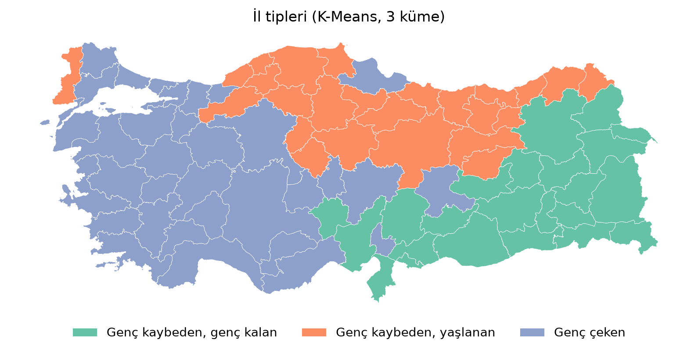

# Gençler Gitti, Yaşlılar Kaldı: Türkiye'de İller Arası Genç Göçü ve Yalnız Yaşlılık

Genç nüfus kaybeden illerde, bütün çocukları başka illerde yaşayan yalnız yaşlıların oranı daha mı yüksek? Bu proje, TÜİK verileriyle bu soruyu Türkiye'nin 81 ili düzeyinde inceleyen bir veri analizi çalışmasıdır.



## Ana bulgu: Aynı göç, farklı sonuç

K-Means kümeleme analizi, illeri genç göçü, yaşlı oranı ve yalnız yaşlılık göstergelerine göre üç tipe ayırdı:

| İl tipi | İl sayısı | Genç göç hızı, 25-34 yaş (binde) | Bütün çocukları başka ilde olan yalnız yaşlılar |
|---|---|---|---|
| Genç çeken | 33 | +29,8 | %15,3 |
| Genç kaybeden, genç kalan | 23 | −202,3 | %12,3 |
| Genç kaybeden, yaşlanan | 25 | −222,3 | %30,2 |

Doğu ve Güneydoğu illeri ile Karadeniz illeri neredeyse aynı yoğunlukta genç kaybediyor. Ancak yaşlanan Karadeniz illerinde, bütün çocukları başka ilde yaşayan yalnız yaşlıların oranı iki buçuk kat daha yüksek. Göçün yaşlılar için ne anlama geldiğini ilin nüfus yapısı belirliyor.

## Önermeler ve sonuçlar

| Önerme | Sonuç |
|---|---|
| **H1:** Genç kaybeden illerde, çocukları başka ilde yaşayan yalnız yaşlıların oranı daha yüksektir. | Kısmen destekleniyor: Yaşlı oranı kontrol edildiğinde ve öğrenci yaşları çıkarıldığında anlamlı, nüfus büyüklüğü eklendiğinde anlamlı değil. |
| **H2:** Yalnız yaşlıların yoğun olduğu iller sağlık hizmetine daha az erişir. | Desteklenmiyor. Yine de 21 il çifte dezavantaj taşıyor. |
| **H3:** Yalnız yaşlılık kadınlara özgüdür ve kadın-erkek yaşam süresi farkıyla ilişkilidir. | Kısmen destekleniyor: Her ilde yalnız yaşlıların çoğunluğu kadın, ancak yaşam süresi farkıyla ilişki yok. |

Ayrıntılı bulgular, tablolar ve sınırlılıklar için [raporu](rapor.md) ([PDF](rapor.pdf)) inceleyebilirsiniz.

## Veri kaynakları

- **TÜİK Merkezi Dağıtım Sistemi (MEDAS):** Yaş gruplarına göre iller arası göç (2008-2025), il nüfusları (2008-2025), hekim ve yatak sayıları (2022-2024), doğuşta beklenen yaşam süresi (2023)
- **TÜİK, İstatistiklerle Yaşlılar 2025:** Tek başına yaşayan yaşlıların çocuklarına uzaklığı ve tek kişilik yaşlı hane oranları
- **geoBoundaries:** Türkiye il sınırları

Bütün veriler, TÜİK'in açıkladığı rakamlarla karşılaştırılarak doğrulanmıştır.

## Yöntemler

- Pearson korelasyonu
- Doğrusal regresyon (OLS, HC3 sağlam standart hatalarla)
- Sağlamlık kontrolleri (öğrenci yaşları hariç göç hızı, deprem bölgesi hariç model)
- K-Means kümeleme
- Coğrafi görselleştirme (GeoPandas)

## Proje yapısı

```
├── README.md
├── rapor.md                       # Proje raporu
├── rapor.pdf                      # Raporun PDF hali
├── requirements.txt               # Python kütüphaneleri
├── gorseller/                     # Grafikler ve haritalar
├── kod/
│   ├── 01_veri_temizleme.ipynb    # Ham verileri okur, temizler, doğrular ve ana tabloyu üretir
│   └── 02_analiz.ipynb            # Betimsel istatistikler, haritalar, regresyon ve kümeleme
└── veri/
    ├── ham/                       # TÜİK ve geoBoundaries'ten indirilen ham dosyalar
    └── islenmis/
        └── ana_tablo.csv          # 81 il, 32 değişkenden oluşan ana tablo
```

Değişkenlerin tanımları raporun "Veri seti sözlüğü" bölümündedir.

## Çalıştırma

```bash
pip install -r requirements.txt
```

1. `kod/01_veri_temizleme.ipynb` dosyasını baştan sona çalıştırın; `veri/islenmis/ana_tablo.csv` oluşturulur.
2. `kod/02_analiz.ipynb` dosyasını baştan sona çalıştırın; analiz sonuçları notebook'ta, görseller `gorseller/` klasöründe oluşturulur.

Proje Python 3.15 ile geliştirilmiştir.

## Medium yazısı

Projenin hikâyesini ve süreçte öğrendiklerimi anlattığım yazı: [Aynı Göç, Farklı Kader: Türkiye'de Yalnız Yaşlılığın Haritası](https://medium.com/@okancc34/t%C3%BCrkiyede-yaln%C4%B1z-ya%C5%9Fl%C4%B1l%C4%B1%C4%9F%C4%B1n-haritas%C4%B1-048542950d0b)

## Veri kullanımı

Bu projede kullanılan veriler TÜİK'e ve geoBoundaries'e aittir ve kaynak gösterilerek kullanılmıştır.
