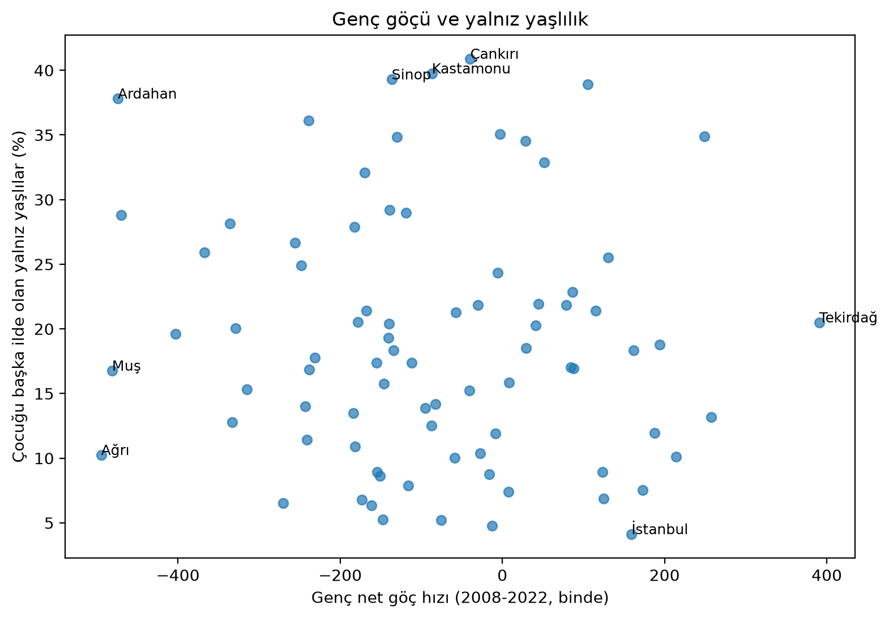
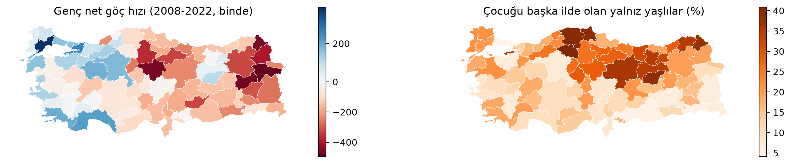
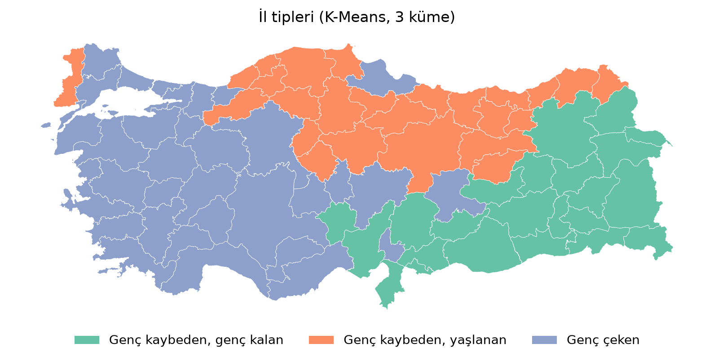

# Gençler Gitti, Yaşlılar Kaldı: Türkiye'de İller Arası Genç Göçü ve Yalnız Yaşlılık

## 1. Konu

Bu proje, TÜİK ve Sağlık Bakanlığı verilerini kullanarak, 2008-2022 döneminde genç nüfus kaybeden illerde çocukları başka illerde yaşayan yalnız yaşlıların oranının daha yüksek olup olmadığını, bu illerde sağlık hizmetlerine erişimin nasıl olduğunu ve yalnız yaşlılığın cinsiyetle ilişkisini 81 il düzeyinde incelemektedir.

Türkiye'de 65 yaş ve üzeri nüfus 2025 yılında 9,6 milyona ulaşmıştır. Bu yaşlıların önemli bir kısmı tek başına yaşamaktadır ve bazı illerde tek başına yaşayan yaşlıların üçte birinden fazlasının bütün çocukları başka illerde yaşamaktadır. Proje, bu durumun gençlerin göçüyle ne ölçüde ilişkili olduğunu sorgulamaktadır.
Literatürde gençlerin göçünün geride kalan yaşlılar üzerindeki etkisi, Orta Anadolu'da bir köy (Coles, 2001), Sivas'ın Zara ilçesi (Güler vd., 2015) ve Kastamonu ile Sinop (Danış, 2023) gibi belirli yerlerde yapılan saha çalışmalarıyla incelenmiştir. İl düzeyindeki sayısal çalışmalar ise ağırlıklı olarak göçün nedenlerine (Aral ve Oğuzlar, 2021) ya da nüfus yaşlanmasının bölgesel örüntülerine (Gurkan ve Gilleard, 1986; Yakar ve Özgür, 2024) odaklanmıştır. Bu proje, saha çalışmalarında gözlenen ilişkiyi 81 il düzeyinde sayısal olarak test etmeyi amaçlamaktadır.

## 2. Araştırma sorusu ve önermeler

**Araştırma sorusu:** Genç nüfus kaybeden illerde, çocukları başka illerde yaşayan yalnız yaşlıların oranı daha mı yüksektir ve bu yaşlılar sağlık hizmetlerine erişim ile cinsiyet açısından nasıl bir tablo içindedir?

Önermeler veri analizine başlamadan önce belirlenmiştir:

- **H1:** Bir ilin son 15 yılda verdiği genç göç, bugün o ildeki çocukları başka ilde yaşayan yalnız yaşlıların oranıyla ilişkilidir. Genç kaybeden illerde bu oran daha yüksektir.
- **H2:** Yalnız yaşlıların yoğun olduğu iller, sağlık hizmetine de daha az erişmektedir. Bu yaşlılar çifte dezavantaj yaşamaktadır.
- **H3:** Yalnız yaşlılık giderek kadınlara özgü bir durum haline gelmektedir ve bu durum kadın-erkek yaşam süresi farkıyla ilişkilidir.

## 3. Veri ve yöntem

### 3.1 Veri kaynakları

Analizde 81 il düzeyinde, resmi kaynaklardan elde edilen veriler kullanılmıştır:

| Veri | Kaynak | Kapsam |
|---|---|---|
| Yaş gruplarına göre illerin aldığı ve verdiği göç | TÜİK MEDAS, Adrese Dayalı Nüfus Kayıt Sistemi | 2008-2025 |
| İller arası göç matrisi | TÜİK MEDAS, Adrese Dayalı Nüfus Kayıt Sistemi | 2008-2025 |
| Yaş gruplarına göre il nüfusları | TÜİK MEDAS, Adrese Dayalı Nüfus Kayıt Sistemi | 2008-2025 |
| Çocuklarına uzaklığa göre tek başına yaşayan yaşlılar | TÜİK, İstatistiklerle Yaşlılar 2025 | 2025 |
| Tek kişilik yaşlı hane oranları (cinsiyete göre) | TÜİK, İstatistiklerle Yaşlılar 2025 | 2025 |
| Hekim sayıları, hekim ve yatak oranları | TÜİK MEDAS, Sağlık İstatistikleri | 2022-2024 |
| Cinsiyete göre doğuşta beklenen yaşam süresi | TÜİK MEDAS, Hayat Tabloları | 2023 |
| İl sınırları | geoBoundaries | - |

İller arası göç matrisi analizde doğrudan kullanılmamış, yaş gruplarına göre göç verisinin doğruluğunu kontrol etmek için kullanılmıştır.

### 3.2 Veri temizleme

Ham dosyalar Python (pandas) ile okunmuş, temizlenmiş ve tek bir ana tabloda birleştirilmiştir. Temel adımlar şunlardır:

- **Satır sınırı:** MEDAS dışa aktarmada yaklaşık 600 satırlık bir sınır uyguladığı için veriler üç dönem halinde (2008-2014, 2015-2021, 2022-2025) indirilip birleştirilmiştir.
- **Anahtar değişken:** Bütün tablolar plaka kodu üzerinden birleştirilmiştir. İl adları kaynaklar arasında farklı yazılabildiği için (örneğin "Hakkari" ve "Hakkâri") il adı anahtar olarak kullanılmamıştır.
- **Eksik değerler:** TÜİK tablolarındaki "-" işaretleri, tablo dipnotu ve satır toplamları dikkate alınarak sıfır kabul edilmiştir. Göç matrisindeki 5 boş hücre de, toplamlar yaş gruplarına göre göç verisiyle karşılaştırılarak sıfır olarak doğrulanmıştır.

Temizlenen veriler her adımda TÜİK'in açıkladığı rakamlarla karşılaştırılarak doğrulanmıştır:

| Kontrol | Sonuç |
|---|---|
| 2025'te iller arası göç eden kişi sayısı | 2.475.019 (TÜİK ile aynı) |
| 2025 Türkiye nüfusu ve 65 yaş üstü nüfus | 86.092.168 ve 9.583.059 (TÜİK ile aynı) |
| Her yıl illerin net göç toplamı | Sıfır (iller arası göç kapalı bir sistemdir) |
| Hesaplanan hekim oranları | 243 il-yıl gözleminin hepsinde TÜİK oranlarıyla aynı |
| Çankırı, Balıkesir ve Hakkari'nin yaşlı göstergeleri | TÜİK'in açıkladığı oranlarla aynı |

Sonuçta 81 il ve 32 değişkenden oluşan, eksik değer içermeyen bir ana tablo (`ana_tablo.csv`) elde edilmiştir.

### 3.3 Değişkenler

**Bağımlı değişkenler:**

- **Çocuğu başka ilde olan yalnız yaşlılar (`farkli_il`):** Tek başına yaşayan yaşlılar içinde, 15 yaş ve üzerindeki çocuklarının hiçbiri aynı ilde yaşamayanların oranı (%). TÜİK bu göstergeyi yaşlının en yakın çocuğunu esas alarak hesaplamaktadır. H1'in bağımlı değişkenidir.
- **Hekim ve yatak oranları:** Bin kişi başına hekim sayısı ve yüz bin kişi başına hastane yatağı (2024). H2'nin bağımlı değişkenleridir. Hekim oranı, TÜİK'in tek ondalığa yuvarlanmış oranları iller arasındaki farkları gizlediği için ham hekim sayıları ve nüfustan yeniden hesaplanmıştır.
- **Tek başına yaşayan yaşlılarda kadın oranı (`tek_yasli_kadin`):** H3'ün bağımlı değişkenidir.

**Temel açıklayıcı değişken: Genç net göç hızı**

Genç net göç hızı, bir ilin 2008-2022 döneminde 15-34 yaş grubunda aldığı göç ile verdiği göç arasındaki farkın, aynı dönemdeki ortalama 15-34 yaş nüfusuna bölünmesiyle hesaplanmıştır (binde). Bu tanımda iki tasarım kararı verilmiştir:

- **15-34 yaş:** Bu aralık, üniversite, iş ve evlilik nedeniyle yapılan göçleri kapsamaktadır. 2022'de iller arası göç edenlerin %59'u bu yaş aralığındadır.
- **2008-2022 dönemi:** Şubat 2023 depremlerinin yol açtığı zorunlu göç ve sonrasındaki geri dönüşler, gençlerin daha iyi yaşam koşulları için yaptığı göçten farklı bir nitelik taşıdığı için 2023-2025 yılları dışarıda bırakılmıştır.

Göç verisi kişileri değil taşınmaları saydığı için bu değişken bir "göç yoğunluğu" ölçüsü olarak yorumlanmalıdır.

**Kontrol değişkenleri:** Yaşlı oranı (65 yaş üstü nüfusun toplam nüfusa oranı, 2025), nüfus büyüklüğü (toplam nüfusun doğal logaritması, 2025), deprem ili (Şubat 2023 depremlerinden etkilenen 11 il için 1, diğerleri için 0) ve kadın-erkek yaşam süresi farkı.

### 3.4 Analiz yöntemleri

- **Korelasyon:** Değişkenler arasındaki ilişkiye ilk bakış için Pearson korelasyon katsayıları hesaplanmıştır.
- **Doğrusal regresyon (OLS):** Önermeler, kontrol değişkenlerini içeren en küçük kareler regresyonuyla test edilmiştir. İller arasında hata varyansının farklı olabileceği dikkate alınarak sağlam standart hatalar (HC3) kullanılmıştır. H1 için üç model analizden önce belirlenmiştir: yalnızca genç göç hızı (Model 1), yaşlı oranının eklendiği model (Model 2) ve deprem ili ile nüfus büyüklüğünün eklendiği model (Model 3).
- **Sağlamlık kontrolleri:** H1'in modelleri, öğrenci yaşları (15-24) dışarıda bırakılarak yalnızca 25-34 yaş göç hızıyla tekrarlanmıştır. Bu kontrol başlangıçta planlanmamış; haritalarda üniversite şehirlerinin beklenmedik biçimde göç alan iller olarak göründüğü fark edildikten sonra eklenmiştir. H3 için ayrıca deprem bölgesindeki 11 ilin çıkarıldığı bir model kurulmuştur.
- **Kümeleme (K-Means):** İller, genç göç hızı (25-34 yaş), yaşlı oranı ve `farkli_il` değişkenleri standartlaştırılarak gözetimsiz bir makine öğrenmesi yöntemi olan K-Means ile gruplanmıştır. Inertia ve silhouette ölçüleri kesin bir küme sayısı göstermediği için, en büyük inertia düşüşünün yaşandığı ve haritalarda gözlenen örüntüyle uyumlu olan 3 küme seçilmiştir. Veri 81 gözlemden oluştuğu için daha karmaşık makine öğrenmesi yöntemleri tercih edilmemiştir.
- **Çifte dezavantaj:** `farkli_il` değeri medyanın üstünde, hekim oranı medyanın altında olan iller "çifte dezavantaj yaşayan iller" olarak tanımlanmıştır.

Analizler Python ile yapılmıştır; kullanılan kütüphaneler `requirements.txt` dosyasında listelenmiştir.

## 4. Bulgular

### 4.1 Betimsel istatistikler

| Değişken | Ortalama | Std. sapma | En düşük | En yüksek |
|---|---|---|---|---|
| Çocuğu başka ilde olan yalnız yaşlılar (%) | 19,03 | 9,69 | 4,12 (İstanbul) | 40,89 (Çankırı) |
| Genç net göç hızı (binde) | −84,98 | 183,69 | −494,69 (Ağrı) | 390,72 (Tekirdağ) |
| Yaşlı oranı (%) | 12,79 | 4,27 | 3,80 (Şırnak) | 21,66 (Sinop) |
| Tek kişilik yaşlı hane payı (%) | 26,15 | 5,13 | 8,29 (Hakkari) | 34,32 (Balıkesir) |
| Bin kişi başına hekim | 2,12 | 0,64 | 1,20 (Şırnak) | 4,57 (Ankara) |
| Yüz bin kişi başına yatak | 299,70 | 83,18 | 130 (Şırnak) | 532 (Elazığ) |
| Tek başına yaşayan yaşlılarda kadın oranı (%) | 72,66 | 3,48 | 61,05 (Tunceli) | 82,48 (Şırnak) |
| Kadın-erkek yaşam süresi farkı (yıl) | 5,44 | 0,57 | 4,10 (Kahramanmaraş) | 7,40 (Rize, Şırnak) |

Genç göç hızının ortalamasının negatif olması, bunun basit bir il ortalaması olmasından kaynaklanmaktadır: Az sayıda büyük il göç alırken çok sayıda küçük il göç vermektedir. Türkiye genelinde illerin net göçlerinin toplamı ise sıfırdır.

### 4.2 H1: Genç göçü ve yalnız yaşlılık

Genç net göç hızı ile çocuğu başka ilde olan yalnız yaşlıların oranı arasındaki korelasyon −0,08'dir; yani Türkiye genelinde belirgin bir ilişki yoktur. Bu oran asıl olarak yaşlı oranıyla ilişkilidir (r = 0,72).



Dağılım grafiği iki zıt örüntüyü göstermektedir. En çok genç kaybeden Ağrı ve Muş'ta çocuğu başka ilde olan yalnız yaşlıların oranı düşüktür (%10 ve %17). Görece az genç kaybeden Çankırı, Sinop ve Kastamonu'da ise bu oran en yüksek düzeydedir (%39-41).



Haritalar, iki göstergenin birlikte yüksek olduğu tek bölgenin İç Anadolu'nun kuzeyi ve doğusu olduğunu göstermektedir. Doğu ve Güneydoğu'da genç nüfus yapısı ve kalabalık aileler, Karadeniz'de ise 2008 öncesine uzanan göç, ilişkiyi Türkiye genelinde gizliyor görünmektedir.

**Tablo 1. H1 regresyon sonuçları (bağımlı değişken: çocuğu başka ilde olan yalnız yaşlılar, %)**

| | Model 1 | Model 2 | Model 3 |
|---|---|---|---|
| Genç göç hızı (binde 100) | −0,414 (0,577) | −1,148\*\* (0,457) | −0,349 (0,398) |
| Yaşlı oranı | | 1,729\*\*\* (0,142) | 1,295\*\*\* (0,136) |
| Deprem ili | | | −0,690 (1,042) |
| Nüfus (log) | | | −4,652\*\*\* (0,667) |
| Sabit | 18,682\*\*\* (1,208) | −4,054\*\* (1,915) | 64,127\*\*\* (9,776) |
| R² | 0,006 | 0,568 | 0,745 |
| N | 81 | 81 | 81 |

*Parantez içinde HC3 sağlam standart hatalar. \* p<0,1; \*\* p<0,05; \*\*\* p<0,01.*

Genç göçü tek başına anlamlı değildir (Model 1). Yaşlı oranı kontrol edildiğinde anlamlı hale gelir: Yaşlı oranı aynı olan iki ilden binde 100 daha fazla genç kaybedeninde, çocuğu başka ilde olan yalnız yaşlıların oranı 1,15 puan daha yüksektir (Model 2). Nüfus büyüklüğü eklendiğinde ise anlamlılığını kaybeder (Model 3). Küçük illerde çocukların il dışına çıkma olasılığı daha yüksektir; ancak bir ilin bugünkü nüfusu kısmen geçmişteki göçün sonucu olduğu için, Model 3 göçün etkisini olduğundan küçük gösteriyor olabilir.

### 4.3 Sağlamlık kontrolü: Öğrenci yaşlarının dışarıda bırakılması

Haritalarda bazı üniversite şehirleri beklenmedik biçimde "genç kazanan" iller olarak görünmüştür. Öğrenci yaşları (15-24) dışarıda bırakıldığında bu şehirlerin aslında çok genç kaybettiği ortaya çıkmaktadır:

| İl | Genç göç hızı, 15-34 yaş (binde) | Genç göç hızı, 25-34 yaş (binde) |
|---|---|---|
| Tunceli | +105 | −175 |
| Bayburt | +51 | −340 |
| Erzincan | +29 | −171 |
| Gümüşhane | −3 | −433 |

**Tablo 2. H1 regresyon sonuçları, 25-34 yaş göç hızıyla**

| | Model 1 | Model 2 | Model 3 |
|---|---|---|---|
| Genç göç hızı, 25-34 yaş (binde 100) | −1,776\*\*\* (0,627) | −1,777\*\*\* (0,507) | −0,550 (0,546) |
| Yaşlı oranı | | 1,639\*\*\* (0,131) | 1,299\*\*\* (0,136) |
| Deprem ili | | | −0,552 (1,018) |
| Nüfus (log) | | | −4,291\*\*\* (0,857) |
| Sabit | 17,011\*\*\* (1,235) | −3,954\*\* (1,790) | 58,941\*\*\* (12,794) |
| R² | 0,109 | 0,631 | 0,748 |
| N | 81 | 81 | 81 |

*Parantez içinde HC3 sağlam standart hatalar. \* p<0,1; \*\* p<0,05; \*\*\* p<0,01.*

Bu ölçüm düzeltmesiyle H1 daha güçlü destek bulmaktadır: Genç göçü Model 1 ve Model 2'de yüksek düzeyde anlamlıdır. Nüfus büyüklüğü eklendiğinde ise yine anlamlılığını kaybetmektedir.

### 4.4 Kümeleme: İl tipleri

K-Means algoritması, illerin konumuna dair hiçbir bilgi almadan, coğrafi olarak bütünlük gösteren üç il tipi bulmuştur:

| İl tipi | İl sayısı | Genç göç hızı, 25-34 yaş (binde) | Yaşlı oranı (%) | Çocuğu başka ilde (%) | Örnek iller |
|---|---|---|---|---|---|
| Genç çeken | 33 | +29,8 | 13,3 | 15,3 | İstanbul, Ankara, İzmir, Antalya, Bursa |
| Genç kaybeden, genç kalan | 23 | −202,3 | 7,6 | 12,3 | Ağrı, Van, Muş, Diyarbakır, Şanlıurfa |
| Genç kaybeden, yaşlanan | 25 | −222,3 | 16,9 | 30,2 | Kastamonu, Sinop, Çankırı, Sivas, Yozgat |



Projenin temel bulgusu bu tablodadır: "Genç kaybeden" iki küme neredeyse aynı oranda genç kaybetmektedir, ancak çocuğu başka ilde olan yalnız yaşlıların oranı yaşlanan kümede iki buçuk kat fazladır. Aynı göç, ilin nüfus yapısına bağlı olarak farklı sonuçlar doğurmaktadır.
Yakar ve Özgür (2024) de ilçe düzeyinde doğurganlık, yaşam süresi ve iç göç göstergelerini kullanarak Türkiye'de farklı özelliklere sahip yaşlanma bölgeleri belirlemiştir; bu projede il düzeyinde bulunan örüntü, yaşlanmanın bölgesel olarak farklılaştığı yönündeki bu bulguyla uyumludur.

### 4.5 H2: Sağlığa erişim

Çocuğu başka ilde olan yalnız yaşlıların oranı ile hekim oranı (r = −0,09) ve yatak oranı (r = 0,03) arasında ilişki bulunmamaktadır. İl tiplerine göre karşılaştırma da benzer bir tablo ortaya koymaktadır:

| İl tipi | Çocuğu başka ilde (%) | Bin kişi başına hekim | Yüz bin kişi başına yatak |
|---|---|---|---|
| Genç çeken | 15,31 | 2,36 | 312,39 |
| Genç kaybeden, genç kalan | 12,27 | 1,73 | 263,70 |
| Genç kaybeden, yaşlanan | 30,17 | 2,18 | 316,08 |

**Tablo 3. H2 regresyon sonuçları**

| | Hekim oranı | Yatak oranı |
|---|---|---|
| Çocuğu başka ilde olan yalnız yaşlılar (%) | 0,024\*\*\* (0,008) | 3,099\*\*\* (1,177) |
| Nüfus (log) | 0,434\*\*\* (0,094) | 41,627\*\*\* (11,450) |
| Sabit | −4,095\*\*\* (1,332) | −312,825\* (168,846) |
| R² | 0,244 | 0,129 |
| N | 81 | 81 |

*Parantez içinde HC3 sağlam standart hatalar. \* p<0,1; \*\* p<0,05; \*\*\* p<0,01.*

H2 desteklenmemektedir. Nüfus büyüklüğü kontrol edildiğinde, yalnız yaşlıların çok olduğu illerde hekim ve yatak oranları beklenenin tersine biraz daha yüksektir. Bunun olası bir nedeni, göç veren illerde nüfus azalırken hekim ve yatak sayısının sabit kalması ve kişi başına düşen oranın bu yüzden yükselmesidir. Sağlık hizmetine erişimin en düşük olduğu il tipi Doğu ve Güneydoğu illeridir.

Genel ilişki bulunmasa da 21 il çifte dezavantaj taşımaktadır. Bunların en başta gelen 10'u şunlardır:

| İl | Çocuğu başka ilde (%) | Bin kişi başına hekim | İl tipi |
|---|---|---|---|
| Çankırı | 40,89 | 1,67 | Genç kaybeden, yaşlanan |
| Kastamonu | 39,76 | 1,76 | Genç kaybeden, yaşlanan |
| Sinop | 39,29 | 1,55 | Genç kaybeden, yaşlanan |
| Ardahan | 37,81 | 1,67 | Genç kaybeden, yaşlanan |
| Gümüşhane | 35,05 | 1,73 | Genç kaybeden, yaşlanan |
| Yalova | 34,89 | 1,81 | Genç çeken |
| Artvin | 34,85 | 1,67 | Genç kaybeden, yaşlanan |
| Bayburt | 32,86 | 1,89 | Genç kaybeden, yaşlanan |
| Yozgat | 28,79 | 1,76 | Genç kaybeden, yaşlanan |
| Amasya | 27,88 | 1,74 | Genç kaybeden, yaşlanan |

### 4.6 H3: Yalnız yaşlılığın cinsiyet boyutu

81 ilin tamamında tek başına yaşayan yaşlıların çoğunluğu kadındır. Bu oran en düşük Tunceli'de (%61,1), en yüksek Şırnak'tadır (%82,5).

Ancak kadın oranı ile kadın-erkek yaşam süresi farkı arasında ilişki bulunmamaktadır (r = −0,03):

**Tablo 4. H3 regresyon sonuçları (bağımlı değişken: tek başına yaşayan yaşlılarda kadın oranı, %)**

| | Model 1 | Model 2 | Deprem hariç |
|---|---|---|---|
| Yaşam süresi farkı (yıl) | −0,199 (1,017) | 0,710 (0,807) | 0,645 (1,065) |
| Yaşlı oranı | | −0,416\*\*\* (0,111) | −0,397\*\*\* (0,132) |
| Deprem ili | | 0,110 (0,717) | |
| Sabit | 73,744\*\*\* (5,379) | 74,100\*\*\* (3,673) | 74,207\*\*\* (4,670) |
| R² | 0,001 | 0,243 | 0,199 |
| N | 81 | 81 | 70 |

*Parantez içinde HC3 sağlam standart hatalar. \* p<0,1; \*\* p<0,05; \*\*\* p<0,01.*

Yaşam süresi farkı üç modelde de anlamlı değildir; deprem bölgesi çıkarıldığında da sonuç değişmemektedir. Beklenmedik bir bulgu olarak, kadın oranı göç veren ve yaşlanan illerde daha düşüktür: Çocuğu başka ilde olan yalnız yaşlıların oranıyla korelasyonu −0,72'dir ve yaşlanan il tipinde kadın oranı %70'e inmektedir (diğer iki tipte yaklaşık %74). Olası bir açıklama, aile desteğinin güçlü olduğu yerlerde eşini kaybeden yaşlı erkeklerin genellikle yalnız yaşamaması, çocukların göç ettiği yerlerde ise erkeklerin de yalnız kalmasıdır.

### 4.7 Bulguların özeti

| Önerme | Sonuç | Temel kanıt |
|---|---|---|
| H1 | Kısmen destekleniyor | Yaşlı oranı kontrol edildiğinde ve öğrenci yaşları çıkarıldığında anlamlı; nüfus büyüklüğü eklendiğinde anlamlı değil. |
| H2 | Desteklenmiyor | Korelasyon sıfıra yakın; nüfus kontrol edildiğinde ilişki ters yönde. |
| H3 | Kısmen destekleniyor | Her ilde yalnız yaşlıların çoğunluğu kadın, ancak yaşam süresi farkıyla ilişki yok. "Giderek" kısmı tek yıllık veriyle test edilememiştir. |

## 5. Sınırlılıklar

- **İl düzeyinde analiz:** Bulgular illerin ortalamalarına dayanmaktadır ve bireyler hakkında kesin bir sonuç vermez. Örneğin "göç veren illerde yalnız yaşlıların oranı yüksektir" bulgusu, çocuğu göç eden her yaşlının yalnız kaldığı anlamına gelmez.
- **Nedensellik:** Analiz değişkenler arasındaki ilişkileri ortaya koymaktadır; bir değişkenin diğerine neden olduğunu kanıtlamamaktadır.
- **Göç verisinin niteliği:** Göç verisi kişileri değil taşınmaları saymaktadır. Aynı kişi birden fazla kez il değiştirebileceği için genç göç hızı bir "göç yoğunluğu" ölçüsü olarak yorumlanmalıdır.
- **Zaman penceresi:** Göç verisi 2008-2022 dönemini kapsamaktadır. Bugünkü yaşlıların çocuklarının önemli bir kısmı daha önceki on yıllarda göç etmiş olabilir; özellikle Karadeniz illerindeki eski göç bu verilerde görünmemektedir.
- **Tek yıllık yaşlı verisi:** Yalnız yaşlılara ilişkin veriler yalnızca 2025 yılına aittir. Bu nedenle H3'ün "giderek" kısmı, yani zaman içindeki değişim test edilememiştir.
- **Göstergenin tanımı:** TÜİK, yaşlının en yakın çocuğunu esas almaktadır. Kalabalık ailelerde çocuklardan biri bile aynı ilde yaşıyorsa yaşlı bu gruba girmemektedir; bu durum doğurganlığın yüksek olduğu illerde oranı düşük gösterebilir. Ayrıca huzurevi gibi kurumlarda yaşayan yaşlılar verinin kapsamı dışındadır.
- **Sağlık erişiminin ölçümü:** Hekim ve yatak oranları il ortalamalarıdır ve köylerde yaşayan yaşlıların sağlık kuruluşlarına olan uzaklığını göstermemektedir. Oranlar bütün nüfusa göre hesaplandığı için yaşlıların daha yoğun sağlık hizmeti ihtiyacını da yansıtmamaktadır.
- **Nüfus büyüklüğü:** Nüfus büyüklüğü hem göçten bağımsız bir etken hem de geçmişteki göçün bir sonucu olabilir. Bu nedenle nüfusun kontrol edildiği modeller göçün etkisini olduğundan küçük gösteriyor olabilir.
- **Yöntemsel kararlar:** Analiz 81 gözleme dayanmaktadır. Küme sayısı kısmen yoruma dayalı olarak seçilmiş, 25-34 yaş sağlamlık kontrolü ise analiz sırasında yapılan bir gözlem üzerine sonradan eklenmiştir.

**İleride yapılabilecek çalışmalar:** Önceki yılların İstatistiklerle Yaşlılar verileriyle zaman içindeki değişim incelenebilir; "nüfusa kayıtlı olunan il" verisiyle on yıllara yayılan göç ölçülebilir; "yaşlı başına hekim" gibi göstergelerle sağlık erişimi daha doğru değerlendirilebilir; iller arası göç matrisiyle gençlerin hangi illere gittiği ortaya konabilir.

## 6. Sonuç

Bu proje, genç nüfus kaybeden illerde çocukları başka illerde yaşayan yalnız yaşlıların oranının daha yüksek olup olmadığını 81 il düzeyinde incelemiştir. Türkiye genelinde genç göçü ile yalnız yaşlılık arasında doğrudan bir ilişki bulunmamıştır. Ancak ilin yaşlı nüfus oranı dikkate alındığında ve öğrenci göçünün yarattığı ölçüm sorunu düzeltildiğinde, genç kaybeden illerde bu oranın daha yüksek olduğu görülmektedir.

Projenin temel bulgusu, aynı göçün farklı sonuçlar doğurmasıdır. Doğu ile Karadeniz illeri benzer oranda genç kaybetmektedir; ancak genç nüfusa ve kalabalık ailelere sahip Doğu illerinde yaşlılar çoğunlukla çocuklarına yakın kalırken, uzun süredir göç veren ve yaşlanan Karadeniz illerinde yalnız yaşlıların yaklaşık üçte birinin bütün çocukları başka illerde yaşamaktadır. Göçün yaşlılar için ne anlama geldiğini, ilin nüfus yapısı belirlemektedir.

Yalnız yaşlıların yoğun olduğu illerde sağlık hizmetine erişimin daha düşük olduğu önermesi desteklenmemiştir. Yalnız yaşlılığın her ilde ağırlıklı olarak kadınlara ait olduğu doğrulanmış, ancak bu durumun kadın-erkek yaşam süresi farkıyla ilişkili olmadığı görülmüştür. Bulgular, yaşlılara yönelik evde bakım ve sosyal hizmet politikalarında, nüfusu yaşlanan ve uzun süredir göç veren illerin, özellikle çifte dezavantaj taşıyan 21 ilin öncelikli olarak ele alınabileceğine işaret etmektedir.

## 7. Referanslar ve bağlantılar

### 7.1 Teorik kaynaklar

- Aral, N. ve Oğuzlar, A. (2021). Türkiye'de iç göçün mekansal analiz yöntemleriyle incelenmesi. *International Journal of Social Inquiry*, 14(2), 447-474. https://doi.org/10.37093/ijsi.901905
- Coles, R. L. (2001). Elderly narrative reflections on the contradictions in Turkish village family life after migration of adult children. *Journal of Aging Studies*, 15(4), 383-406. https://doi.org/10.1016/S0890-4065(01)00030-5
- Danış, D. (2023). Ageing population and elderly care in the context of rural-urban relations: The case of Kastamonu and Sinop. *Journal of Social Policy Conferences*, 85, 1-30. https://doi.org/10.26650/jspc.2023.85.1270477
- Güler, Z., Özsel, D. ve Güler, N. (2015). Arafta kalan yaşlılar: Kırdan kente göçün yaşlılara etkisi. *Sosyoloji Konferansları*, 52, 685-713.
- Gurkan, A. A. ve Gilleard, C. J. (1986). Inter-provincial patterns of ageing in Turkey: A socio-economic analysis. *Ageing and Society*, 6(4), 435-452.
- Yakar, M. ve Özgür, E. M. (2024). Revealing ageing regions through spatial patterns: The evidence from Türkiye. *Finisterra*, 59(125), 105-123. https://doi.org/10.18055/Finis32411

### 7.2 Veri kaynakları

- TÜİK Merkezi Dağıtım Sistemi (MEDAS): Göç, nüfus, sağlık ve hayat tablosu verileri. https://biruni.tuik.gov.tr/medas/?locale=tr (Erişim: Kasım 2026)
- TÜİK, İstatistiklerle Yaşlılar 2025. https://veriportali.tuik.gov.tr/tr/press/58231 (Erişim: Kasım 2026)
- geoBoundaries, Türkiye il sınırları (ADM1). https://www.geoboundaries.org (Erişim: Kasım 2026)
- Runfola, D. vd. (2020). geoBoundaries: A global database of political administrative boundaries. *PLoS ONE*, 15(4), e0231866.

### 7.3 Yazılım

Analizler Python ile yapılmıştır. Kullanılan başlıca kütüphaneler: pandas, NumPy, statsmodels, scikit-learn, GeoPandas ve Matplotlib.

## 8. Veri seti sözlüğü

Bu sözlük, analizde kullanılan ana tabloyu (`veri/islenmis/ana_tablo.csv`) tanımlamaktadır. Tablo 81 satırdan (her il için bir satır) ve 32 sütundan oluşmaktadır; eksik değer içermemektedir.

### 8.1 Anahtar

- **Anahtar değişken:** `il_kodu` (plaka kodu, 1-81). Her il için benzersizdir ve bütün kaynak tablolar bu değişken üzerinden birleştirilmiştir.
- `il_adi` yalnızca okunabilirlik için tutulmaktadır ve anahtar olarak kullanılmamalıdır; il adları kaynaklar arasında farklı yazılabilmektedir (örneğin "Hakkari" ve "Hakkâri").

### 8.2 Lejant

- **Yaşlı:** 65 yaş ve üzerindeki kişiler
- **Genç:** 15-34 yaş arasındaki kişiler (`genc2_goc_hizi` için 25-34)
- **Yalnız yaşlı:** Tek başına yaşayan, yani tek kişilik bir hanede yaşayan yaşlı
- **%:** Yüzde; **binde:** Bin kişi başına
- **0/1:** Kukla değişken; 1 "evet", 0 "hayır" anlamına gelir
- **TÜİK:** Türkiye İstatistik Kurumu; **MEDAS:** TÜİK Merkezi Dağıtım Sistemi; **ADNKS:** Adrese Dayalı Nüfus Kayıt Sistemi

### 8.3 Kimlik değişkenleri

| Değişken | Açıklama | Birim |
|---|---|---|
| `il_kodu` | İlin plaka kodu (anahtar) | 1-81 |
| `il_adi` | İlin adı | Metin |

### 8.4 Yalnız yaşlıların çocuklarına uzaklığı (TÜİK, İstatistiklerle Yaşlılar 2025)

Oranlar, tek başına yaşayan yaşlılar içinde hesaplanmıştır ve her ilde toplamları 100'dür. TÜİK, yaşlının 15 yaş ve üzerindeki çocuklarından en yakın olanını esas almaktadır.

| Değişken | Açıklama | Birim |
|---|---|---|
| `cocugu_yok` | 15 yaş ve üzerinde çocuğu olmayanlar | % |
| `ayni_bina` | En yakın çocuğu aynı binada yaşayanlar | % |
| `ayni_sokak` | En yakın çocuğu aynı sokakta yaşayanlar | % |
| `ayni_mahalle` | En yakın çocuğu aynı mahallede yaşayanlar | % |
| `ayni_ilce` | En yakın çocuğu aynı ilçede, farklı mahallede yaşayanlar | % |
| `farkli_ilce` | En yakın çocuğu aynı ilde, farklı ilçede yaşayanlar | % |
| `farkli_il` | En yakın çocuğu başka bir ilde yaşayanlar (H1'in bağımlı değişkeni) | % |
| `yurtdisi` | En yakın çocuğu yurtdışında yaşayanlar | % |
| `bilinmeyen` | Bilgisi olmayanlar | % |

### 8.5 Yaşlı haneleri (TÜİK, İstatistiklerle Yaşlılar 2025)

| Değişken | Açıklama | Birim |
|---|---|---|
| `yasli_hane_orani` | En az bir yaşlının yaşadığı hanelerin bütün haneler içindeki oranı | % |
| `tek_yasli_hane_orani` | Tek kişilik yaşlı hanelerin bütün haneler içindeki oranı | % |
| `tek_yasli_tek_kisilik_icinde` | Tek kişilik yaşlı hanelerin bütün tek kişilik haneler içindeki oranı | % |
| `tek_yasli_erkek` | Tek başına yaşayan yaşlılar içinde erkeklerin oranı | % |
| `tek_yasli_kadin` | Tek başına yaşayan yaşlılar içinde kadınların oranı (H3'ün bağımlı değişkeni) | % |

### 8.6 Göç ve nüfus (TÜİK MEDAS, ADNKS)

| Değişken | Açıklama | Birim |
|---|---|---|
| `genc_aldigi` | İlin 2008-2022 döneminde 15-34 yaş grubunda aldığı toplam göç | Kişi |
| `genc_verdigi` | İlin 2008-2022 döneminde 15-34 yaş grubunda verdiği toplam göç | Kişi |
| `genc_net_goc` | Genç net göç: `genc_aldigi` − `genc_verdigi` | Kişi |
| `toplam_nufus` | İlin 2025 nüfusu | Kişi |
| `yasli_nufus` | İlin 2025'teki 65 yaş ve üzeri nüfusu | Kişi |
| `ort_genc_nufus` | İlin 2008-2022 dönemindeki ortalama 15-34 yaş nüfusu | Kişi |
| `yasli_orani` | 65 yaş ve üzeri nüfusun toplam nüfusa oranı (2025) | % |
| `genc_goc_hizi` | Genç net göç hızı: `genc_net_goc` / `ort_genc_nufus` × 1000 (H1'in açıklayıcı değişkeni) | Binde |
| `genc2_goc_hizi` | Aynı hesaplamanın yalnızca 25-34 yaş grubu için yapılmış hali (sağlamlık kontrolü) | Binde |

Göç verisi kişileri değil taşınmaları saymaktadır; aynı kişi dönem içinde birden fazla kez göç etmiş olabilir.

### 8.7 Sağlık (TÜİK MEDAS, Sağlık İstatistikleri)

| Değişken | Açıklama | Birim |
|---|---|---|
| `hekim_orani` | Bin kişi başına hekim sayısı (2024). Uzman, pratisyen ve asistan hekimler toplanıp il nüfusuna bölünerek hesaplanmıştır; diş hekimleri dahil değildir. | Bin kişi başına |
| `yatak_orani` | Yüz bin kişi başına hastane yatağı (2024) | Yüz bin kişi başına |

### 8.8 Yaşam beklentisi (TÜİK MEDAS, Hayat Tabloları)

| Değişken | Açıklama | Birim |
|---|---|---|
| `yasam_erkek` | Erkeklerde doğuşta beklenen yaşam süresi (2023) | Yıl |
| `yasam_kadin` | Kadınlarda doğuşta beklenen yaşam süresi (2023) | Yıl |
| `yasam_farki` | Kadın-erkek yaşam süresi farkı: `yasam_kadin` − `yasam_erkek` | Yıl |

### 8.9 Türetilen değişkenler

| Değişken | Açıklama | Birim |
|---|---|---|
| `tek_yasli_payi` | En az bir yaşlının yaşadığı haneler içinde tek kişilik yaşlı hanelerin oranı: `tek_yasli_hane_orani` / `yasli_hane_orani` × 100 | % |
| `deprem_ili` | Şubat 2023 depremlerinden etkilenen 11 il için 1 (Adana, Adıyaman, Diyarbakır, Elazığ, Gaziantep, Hatay, Kahramanmaraş, Kilis, Malatya, Osmaniye, Şanlıurfa), diğer iller için 0 | 0/1 |

Analiz notebook'unda ayrıca dört değişken üretilmiştir, ancak bunlar `ana_tablo.csv` dosyasında yer almamaktadır: `goc_hizi_100` ve `goc2_hizi_100` (göç hızlarının 100'e bölünmüş halleri), `log_nufus` (toplam nüfusun doğal logaritması) ve `kume` (K-Means küme numarası).

## 9. Kullanılan dosyalar

### 9.1 Klasör yapısı

```
softito_proje_final/
├── rapor.md
├── requirements.txt
├── gorseller/
├── kod/
└── veri/
    ├── ham/
    └── islenmis/
```


### 9.2 Ham veri dosyaları (`veri/ham/`)

| Dosya | Açıklama | Kaynak |
|---|---|---|
| `goc_yas_2008_2014.csv`, `goc_yas_2015_2021.csv`, `goc_yas_2022_2025.csv` | İllerin yaş gruplarına göre aldığı ve verdiği göç | TÜİK MEDAS |
| `goc_matrisi_2008_2014.csv`, `goc_matrisi_2015_2021.csv`, `goc_matrisi_2022_2025.csv` | İller arası göç akışları (doğrulama için kullanılmıştır) | TÜİK MEDAS |
| `nufus_yas_2008_2014.csv`, `nufus_yas_2015_2021.csv`, `nufus_yas_2022_2025.csv` | Yaş gruplarına göre il nüfusları | TÜİK MEDAS |
| `yasli_cocuk_yakinlik_2025.xls` | Tek başına yaşayan yaşlıların çocuklarına uzaklığı | TÜİK, İstatistiklerle Yaşlılar 2025 |
| `yasli_hanehalki_2025.xls` | Tek kişilik yaşlı hane oranları (cinsiyete göre) | TÜİK, İstatistiklerle Yaşlılar 2025 |
| `saglik_personel_2022_2024.csv` | Unvana göre hekim sayıları | TÜİK MEDAS, Sağlık İstatistikleri |
| `saglik_yatak_orani_2022_2024.csv` | Yüz bin kişi başına hastane yatağı | TÜİK MEDAS, Sağlık İstatistikleri |
| `saglik_hekim_orani_2022_2024.csv` | Bin kişi başına hekim (doğrulama için kullanılmıştır) | TÜİK MEDAS, Sağlık İstatistikleri |
| `yasam_beklentisi_2023.csv` | Cinsiyete göre doğuşta beklenen yaşam süresi | TÜİK MEDAS, Hayat Tabloları |
| `il_sinirlari.geojson` | 81 ilin sınırları (haritalar için) | geoBoundaries |

MEDAS dosyaları, sistemin dışa aktarmada uyguladığı satır sınırı nedeniyle üç dönem halinde indirilmiştir.

### 9.3 İşlenmiş veri (`veri/islenmis/`)

| Dosya | Açıklama |
|---|---|
| `ana_tablo.csv` | Bütün ham verilerin temizlenip plaka kodu üzerinden birleştirildiği ana tablo (81 il, 32 değişken). Değişkenlerin tanımları 8. bölümdedir. |

### 9.4 Kod dosyaları (`kod/`)

| Dosya | Açıklama |
|---|---|
| `01_veri_temizleme.ipynb` | Ham dosyaları okur, temizler, TÜİK rakamlarıyla doğrular ve `ana_tablo.csv` dosyasını üretir. |
| `02_analiz.ipynb` | `ana_tablo.csv` dosyasını kullanarak betimsel istatistikleri, haritaları, regresyonları ve kümeleme analizini yapar; görselleri `gorseller/` klasörüne kaydeder. |

### 9.5 Görseller (`gorseller/`)

| Dosya | Açıklama |
|---|---|
| `h1_dagilim.png` | Genç göç hızı ile çocuğu başka ilde olan yalnız yaşlıların oranı (dağılım grafiği) |
| `h1_haritalar.png` | Aynı iki değişkenin il haritaları |
| `kumeler_harita.png` | K-Means ile belirlenen üç il tipinin haritası |

### 9.6 Diğer dosyalar

| Dosya | Açıklama |
|---|---|
| `rapor.md` | Bu rapor |
| `requirements.txt` | Projede kullanılan Python kütüphanelerinin listesi |

### 9.7 Projenin çalıştırılması

1. Gerekli kütüphaneleri kurun: `pip install -r requirements.txt`
2. `kod/01_veri_temizleme.ipynb` dosyasını baştan sona çalıştırın; `veri/islenmis/ana_tablo.csv` dosyası oluşturulacaktır.
3. `kod/02_analiz.ipynb` dosyasını baştan sona çalıştırın; analiz sonuçları notebook'ta, görseller `gorseller/` klasöründe oluşturulacaktır.

Proje Python 3.15 ile geliştirilmiştir.
